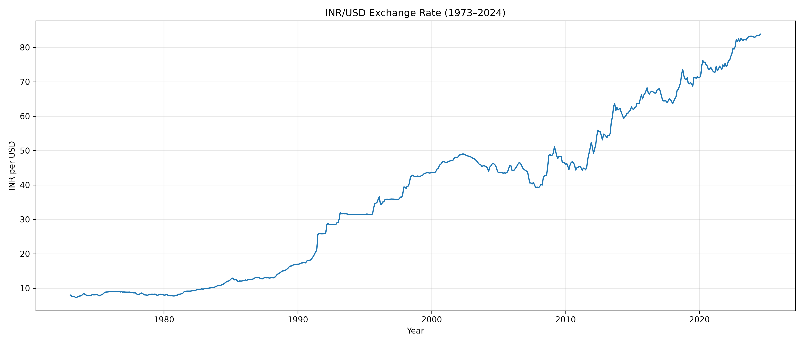
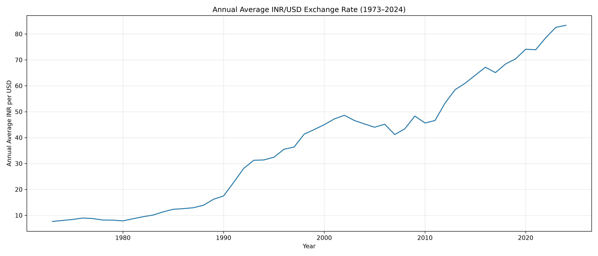
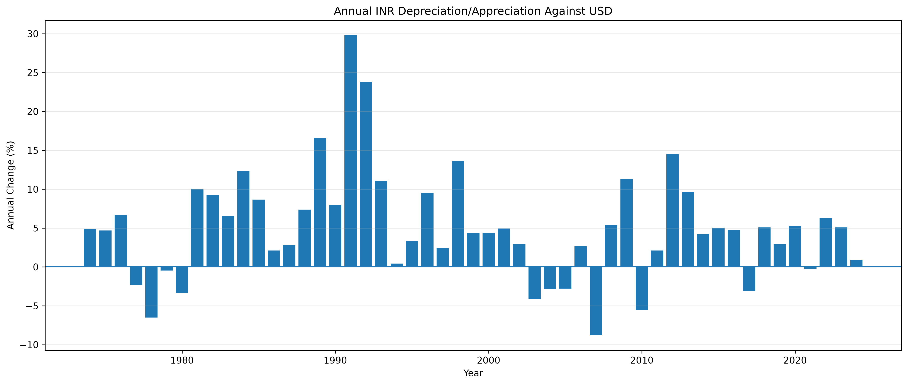
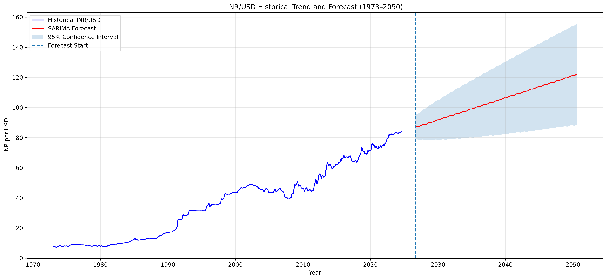
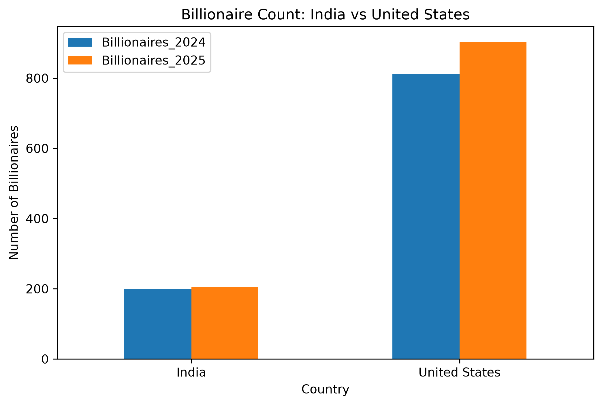

# INR/USD Exchange Rate Trend Analysis and Forecasting (1947--2050)

## Project Overview

This project analyzes the historical movement of the Indian Rupee (INR)
against the US Dollar (USD), examines major economic events influencing
rupee depreciation and devaluation, and develops a statistical forecast
of the INR/USD exchange rate from September 2026 to August 2050.

The project also compares India and the United States across inflation
trends, monetary policy frameworks, billionaire population growth, and
happiness rankings.

The primary objective is to understand long-term exchange-rate movements
and explore the relationship between inflation, monetary policy, and
economic stability.

## Research Objectives

-   Analyze historical INR/USD exchange-rate movements from 1947 to
    2024.
-   Identify major economic events associated with rupee devaluation and
    depreciation.
-   Examine long-term exchange-rate trends.
-   Develop and evaluate time-series forecasting models using ARIMA and
    SARIMA.
-   Forecast INR/USD from September 2026 through August 2050.
-   Compare inflation trends and monetary policy frameworks in India and
    the United States.
-   Examine billionaire population growth and happiness rankings.

## Technologies Used

-   Python
-   Pandas
-   NumPy
-   Matplotlib
-   Seaborn
-   Statsmodels
-   Scikit-learn
-   Jupyter Notebook

## Project Structure

``` text
INR_USD_Trend_Analysis/
│
├── data/
│   ├── raw/
│   └── processed/
│
├── notebooks/
│   ├── 01_Data_Collection.ipynb
│   ├── 02_Historical_Data_1947_1972.ipynb
│   ├── 03_Forecasting_INR_USD.ipynb
│   └── 04_India_US_Comparison.ipynb
│
├── visualizations/
│
├── references/
├── reports/
├── src/
│
├── README.md
├── requirements.txt
└── .gitignore
```

## Data Sources

The project uses data and information from the following sources:

-   **Federal Reserve Economic Data (FRED):** Historical INR/USD
    exchange-rate data from 1973 to August 2024.
-   **Reserve Bank of India (RBI):** Historical exchange-rate
    information and monetary policy rates.
-   **World Bank:** Annual consumer price inflation data for India and
    the United States.
-   **Forbes:** Billionaire population statistics for 2024 and 2025.
-   **World Happiness Report:** Country happiness rankings for 2025.
-   **Federal Reserve:** US monetary policy framework and inflation
    objective.

## Methodology

### 1. Historical Exchange Rate Analysis

-   Collected historical exchange-rate observations covering 1947--2024.
-   Examined major changes in the INR/USD exchange rate.
-   Calculated annual averages and percentage changes.
-   Identified periods of significant rupee depreciation.
-   Visualized long-term exchange-rate movements.

Historical data from different periods have different frequencies and
definitions. These datasets are analyzed with those differences in mind
rather than treated as one continuous monthly series.

### 2. Time-Series Forecasting

The following forecasting models were evaluated:

-   ARIMA (1,1,1)
-   ARIMA (2,1,2)
-   SARIMA (1,1,1)(1,1,1,12)
-   Holt's Damped Trend
-   Log-Linear Regression

Model performance was evaluated using:

-   Mean Absolute Error (MAE)
-   Root Mean Squared Error (RMSE)
-   Mean Absolute Percentage Error (MAPE)

SARIMA produced the lowest error among the evaluated models in the
initial test comparison.

### 3. Long-Term Forecasting

The selected SARIMA model was fitted using historical exchange-rate data
through August 2024.

**Forecast period: September 2026 -- August 2050**

The forecast includes:

-   Monthly predicted exchange rates.
-   Lower 95% confidence bounds.
-   Upper 95% confidence bounds.

The forecast is based on historical time-series patterns and is intended
as a statistical baseline rather than a guaranteed prediction of future
exchange rates.

### 4. India--United States Economic Comparison

The comparative analysis examines:

-   Inflation targets.
-   Actual CPI inflation trends (2000--2024).
-   Average inflation and inflation volatility.
-   RBI and Federal Reserve monetary policy frameworks.
-   Billionaire population growth (2024--2025).
-   World Happiness Report rankings (2025).

## Key Findings

### 1. Exchange Rate Forecasting

-   SARIMA performed better than the other evaluated models in the
    initial test comparison.
-   The forecast indicates a continued upward trend in INR per USD.
-   The predicted exchange rate reaches approximately ₹122 per USD by
    August 2050.
-   The prediction interval widens substantially over the forecast
    horizon.

### 2. India--United States Inflation Comparison (2000--2024)

  Metric                                         India   United States
  ------------------------------------------- -------- ---------------
  Average inflation                              6.09%           2.58%
  Median inflation                               5.13%           2.44%
  Inflation volatility (standard deviation)       2.49            1.63
  Minimum inflation                              3.33%          -0.36%
  Maximum inflation                             11.99%           8.00%

India experienced higher average CPI inflation and greater inflation
variability than the United States during the period studied.

### 3. Monetary Policy Comparison

  -----------------------------------------------------------------------
  Feature                 India -- RBI            United States --
                                                  Federal Reserve
  ----------------------- ----------------------- -----------------------
  Primary objective       Price stability with    Maximum employment and
                          growth                  price stability

  Inflation measure       CPI                     PCE

  Inflation target        4% (2%--6% band)        2% long-run goal

  Main policy rate        Repo rate               Federal funds rate

  Decision-making body    Monetary Policy         Federal Open Market
                          Committee               Committee

  Policy framework        Flexible inflation      Dual mandate
                          targeting               
  -----------------------------------------------------------------------

The comparison highlights differences in inflation measurement, policy
objectives, and central-bank decision-making frameworks.

### 4. Billionaire Population and Happiness

The project also examines billionaire population growth between 2024 and
2025 and compares the 2025 World Happiness Report rankings of India and
the United States.

The analysis provides additional economic and social context for the two
countries.

## Results and Visualizations

The following visualizations summarize the major findings of the
project. The image paths are relative to the repository root and will
display on GitHub when the `visualizations` folder is included in the
repository.

### 1. Historical INR/USD Exchange Rate (1947--1971)


### 2. Monthly INR/USD Exchange Rate (1973--2024)



### 3. Annual INR/USD Exchange Rate Trend (1973--2024)



### 4. Annual INR Depreciation Analysis



### 5. ARIMA Model -- Actual vs Predicted


### 6. SARIMA Model -- Actual vs Predicted


### 7. Long-Term INR/USD Forecast (2026--2050)



### 8. India--United States Actual Inflation (2000--2024)


### 9. India--United States Inflation Targets


### 10. Billionaire Population Comparison (2024--2025)



### 11. World Happiness Rankings (2025)


## Limitations

-   Historical exchange-rate datasets have different frequencies and
    definitions across periods.
-   Some historical observations are based on manually compiled
    historical data.
-   The long-term forecast is based on historical exchange-rate patterns
    rather than a complete macroeconomic forecasting framework.
-   The model does not incorporate all factors influencing exchange
    rates, such as GDP growth, interest rates, foreign exchange
    reserves, trade balances, and geopolitical developments.
-   The long-term forecast has considerable uncertainty and should not
    be interpreted as a guaranteed future exchange rate.
-   Inflation targets are not the same as actual inflation rates.
-   The RBI and Federal Reserve use different inflation measures and
    operate under different monetary policy frameworks.
-   The additional validation period overlaps the original test period,
    so it should not be interpreted as an independent validation result.

## How to Run the Project

### 1. Clone the Repository

``` bash
git clone <YOUR_GITHUB_REPOSITORY_URL>
```

### 2. Navigate to the Project Directory

``` bash
cd INR_USD_Trend_Analysis
```

### 3. Install Dependencies

``` bash
pip install -r requirements.txt
```

### 4. Launch JupyterLab

``` bash
python -m jupyter lab
```

### 5. Run the Notebooks

Run the notebooks in numerical order:

1.  `01_Data_Collection.ipynb`
2.  `02_Historical_Data_1947_1972.ipynb`
3.  `03_Forecasting_INR_USD.ipynb`
4.  `04_India_US_Comparison.ipynb`

## Future Improvements

-   Incorporate GDP growth, interest rates, foreign exchange reserves,
    and trade balances into forecasting models.
-   Explore machine-learning forecasting techniques.
-   Perform rolling-origin time-series validation.
-   Investigate the impact of major geopolitical and economic events.
-   Compare forecast performance across different model specifications.
-   Explore multivariate forecasting approaches to improve long-term
    exchange-rate analysis.

## Academic Information

**Course:** COMP-670 -- Big Data\
**Institution:** Rivier University

## Author

Developed as an academic data analytics and time-series forecasting
project.

------------------------------------------------------------------------

*This project is developed for academic and educational purposes.
Forecasts are statistical estimates and are not financial advice.*
